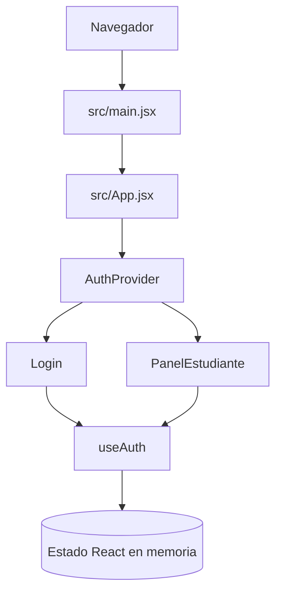
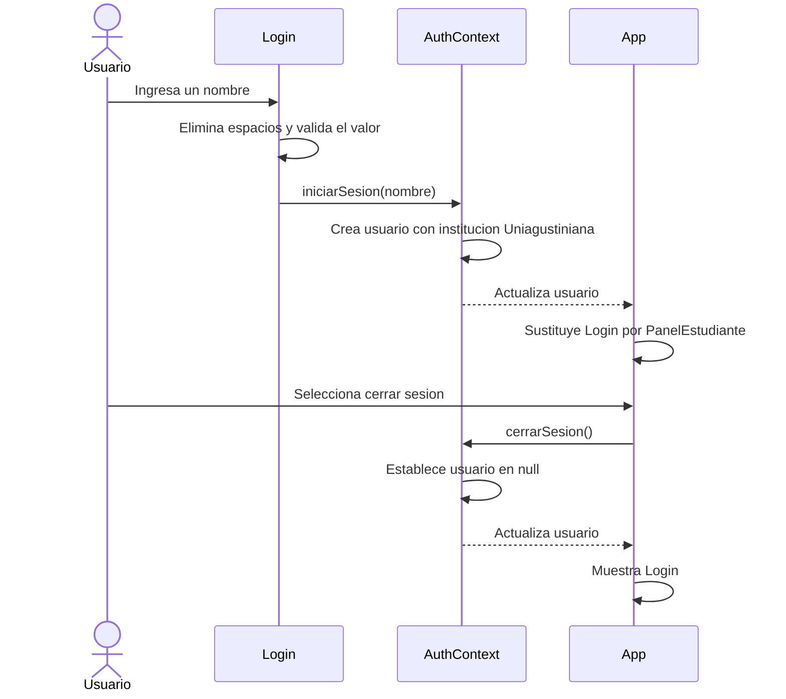

# auth-agustiniana

[](#)
[](https://react.dev/)
[](https://vitejs.dev/)

## Descripción

**auth-agustiniana** es una aplicación web prototipo desarrollada para demostrar un flujo sencillo de acceso estudiantil mediante React. Permite introducir un nombre de usuario, guardar ese valor en el estado de la aplicación y mostrar un panel de bienvenida identificado con Uniagustiniana.

La aplicación está dirigida a estudiantes o evaluadores que necesiten visualizar el comportamiento básico del flujo de interfaz y al proyecto no dispone de backend, persistencia ni autenticación real.

## Tabla de contenidos

- [Características principales](#características-principales)
- [Arquitectura](#arquitectura)
- [Stack tecnológico](#stack-tecnológico)
- [Estructura del proyecto](#estructura-del-proyecto)
- [Requisitos previos](#requisitos-previos)
- [Instalación y configuración](#instalación-y-configuración)
- [Variables de entorno](#variables-de-entorno)
- [Uso](#uso)
- [Testing](#testing)
- [Despliegue](#despliegue)
- [Información pendiente](#información-pendiente)

## Características principales

- Formulario de ingreso con nombre de usuario.
- Validación mínima del campo: rechaza cadenas vacías o compuestas solo por espacios.
- Almacenamiento temporal del usuario mediante React Context y estado local.
- Vista condicional entre el formulario de acceso y el panel estudiantil.
- Cierre de sesión que elimina el usuario del estado de la aplicación.
- Configuración de desarrollo, compilación, vista previa y análisis estático mediante Vite y ESLint.

## Arquitectura

### Visión general y principios de diseño

La aplicación es una SPA renderizada completamente en el navegador. No contiene API, servicios externos ni base de datos.

La organización actual separa la entrada de la aplicación, el compositor de vistas, el formulario de acceso y el contexto de autenticación. `AuthProvider` concentra el estado de usuario y expone las operaciones de inicio y cierre de sesión a los componentes descendientes mediante el hook `useAuth`.

### Diagrama de arquitectura



### Flujo principal



### Módulos

| Módulo | Responsabilidad |
|---|---|
| `src/main.jsx` | Inicializa React, aplica `StrictMode` y monta `App`. |
| `src/App.jsx` | Compone el proveedor de autenticación, selecciona la vista activa y muestra el panel estudiantil. |
| `src/Auth-Context.jsx` | Define el contexto, mantiene el usuario y expone las acciones de acceso y cierre. |
| `src/Login.jsx` | Captura el nombre, valida el campo y solicita el inicio de sesión. |
| `src/index.css` | Define los estilos globales. |
| `vite.config.js` | Configura el plugin React para Vite. |

### Modelo de datos

El único modelo existente reside en memoria y se define al iniciar sesión:

```text
Usuario
- nombre: valor introducido en el formulario
- institucion: "Uniagustiniana"
```

El estado inicial es `null`. No existe persistencia entre recargas ni una entidad de credenciales.

### Decisiones técnicas

- **SPA con React:** permite representar las vistas de acceso y panel sin navegación entre rutas.
- **React Context:** evita pasar el usuario y las acciones de autenticación mediante propiedades entre los componentes principales.
- **Estado local del navegador:** es suficiente para el prototipo actual, que no necesita backend ni persistencia.
- **Vite:** proporciona servidor de desarrollo y compilación de la aplicación frontend.

### Consideraciones

- **Seguridad:** el flujo actual solo simula el acceso en memoria; cualquier valor de texto no vacío abre el panel. No debe utilizarse como autenticación real ni para proteger información.
- **Escalabilidad:** la aplicación es independiente y ligera, pero la arquitectura necesitaría backend, almacenamiento seguro y gestión de sesiones para ampliar el alcance.
- **Rendimiento:** React actualiza una cantidad mínima de componentes y la compilación produce recursos estáticos optimizados por Vite.

## Stack tecnológico

| Tecnología | Versión declarada | Rol |
|---|---|---|
| React | `^19.2.5` | Construcción de la interfaz y gestión de estado. |
| React DOM | `^19.2.5` | Montaje y renderizado en el DOM del navegador. |
| Vite | `^8.0.10` | Servidor de desarrollo y compilación frontend. |
| `@vitejs/plugin-react` | `^6.0.1` | Integración de React y JSX con Vite. |
| ESLint | `^10.2.1` | Análisis estático del código JavaScript y JSX. |
| npm | `package-lock.json` bloquea dependencias con lockfile versión 3 | Gestión de paquetes e instalación reproducible. |

## Estructura del proyecto

```text
auth-agustiniana/
├── public/
│   ├── favicon.svg             # Icono usado por la página
│   └── icons.svg               # Recursos gráficos públicos
├── src/
│   ├── assets/
│   │   ├── hero.png            # Recurso de imagen
│   │   ├── react.svg           # Recurso gráfico de React
│   │   └── vite.svg            # Recurso gráfico de Vite
│   ├── App.jsx                 # Composición principal y vistas
│   ├── Auth-Context.jsx        # Contexto y estado de usuario
│   ├── Login.jsx               # Formulario de acceso
│   ├── App.css                 # Estilos específicos de la plantilla
│   ├── index.css               # Estilos globales
│   └── main.jsx                # Punto de entrada de React
├── eslint.config.js            # Reglas ESLint
├── index.html                  # Documento HTML de entrada
├── package-lock.json           # Dependencias bloqueadas
├── package.json                # Scripts y dependencias
└── vite.config.js              # Configuración de Vite
```

## Requisitos previos

- Node.js: `<!-- TODO: completar a partir de la compatibilidad oficial de Vite 8 y del entorno objetivo -->`
- npm incluido con Node.js.
- Navegador moderno compatible con módulos ES.

## Instalación y configuración

### 1. Clonar el repositorio

```bash
git clone <!-- TODO: completar URL del repositorio -->
cd auth-agustiniana
```

### 2. Instalar dependencias

```bash
npm ci
```

### 3. Iniciar el servidor de desarrollo

```bash
npm run dev
```

Vite mostrará la dirección local disponible en la terminal, normalmente en `http://localhost:5173`.

### 4. Comprobar la compilación

```bash
npm run build
```

Los archivos de producción se generan en `dist/`.

## Variables de entorno

El proyecto no referencia variables de entorno ni incluye un archivo `.env.example`.

| Variable | Descripción | Obligatoria | Ejemplo |
|---|---|---|---|
| Ninguna | No se requiere configuración por variables de entorno. | No aplica | No aplica |

## Uso

### Iniciar la aplicación en desarrollo

```bash
npm run dev
```

1. Abra la dirección local indicada por Vite.
2. Escriba un nombre en el campo **Nombre de usuario**.
3. Seleccione **Ingresar al Portal**.
4. El panel mostrará el nombre introducido y la institución `Uniagustiniana`.
5. Seleccione **Cerrar Sesión Segura** para volver al formulario.

### Generar los archivos de producción

```bash
npm run build
```

### Previsualizar la compilación

```bash
npm run preview
```

## Testing

No existen archivos ni scripts de pruebas automatizadas en el repositorio. Sí está disponible el análisis estático:

```bash
npm run lint
```

La configuración de ESLint inspecciona archivos JavaScript y JSX, excluye `dist/` e incluye reglas recomendadas, React Hooks y React Refresh.

Al momento de documentar el proyecto, `npm run lint` reporta estas incidencias conocidas y verificadas:

- Importaciones de `React` sin uso en `src/App.jsx`, `src/Auth-Context.jsx` y `src/Login.jsx`.
- Una exportación de `useAuth` desde el mismo módulo que exporta el componente `AuthProvider`, incompatible con la regla de Fast Refresh configurada.

## Despliegue

Al tratarse de una aplicación frontend sin backend ni variables de entorno, el resultado de compilación puede publicarse como sitio estático.

```bash
npm run build
```

El contenido publicado debe provenir de `dist/`. El proveedor, las instrucciones específicas y el dominio de despliegue no están definidos en el repositorio; no se proporciona una configuración de hosting, Docker ni CI/CD.

## Información pendiente

- `<!-- TODO: completar -->` URL de clonación del repositorio.
- `<!-- TODO: completar -->` versión mínima y máxima de Node.js soportada.
- `<!-- TODO: completar -->` licencia del proyecto.
- `<!-- TODO: completar -->` autores, mantenedores y canal oficial de contacto.
- `<!-- TODO: completar -->` convenciones de ramas, commits y pull requests.
- `<!-- TODO: completar -->` métricas o alcance de pruebas automatizadas.
- `<!-- TODO: completar -->` estrategia y plataforma de despliegue.
- `<!-- TODO: completar -->` integración con un backend real y mecanismo de autenticación seguro.
